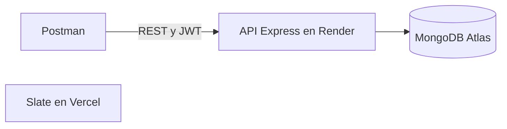

# Slate

Slate es una aplicación web para organizar y dar seguimiento a postulaciones de empleo. Permite registrar ofertas, revisar su avance y guardar notas de cada contacto.

Proyecto final (TPF) del curso de Ada.

## Demo

Versión publicada en Vercel: [job-tracker-opal-nine.vercel.app](https://job-tracker-opal-nine.vercel.app/)

## Funciones

- Crear, editar y eliminar postulaciones, con confirmación antes de borrar.
- Seguir seis etapas del proceso y registrar el resultado.
- Añadir y editar actividades, fechas, notas y seguimientos.
- Filtrar postulaciones activas y cerradas.
- Cambiar el idioma entre español e inglés y alternar el modo claro y oscuro.
- Adaptar los formularios y la vista a pantallas móviles y de escritorio.
- Guardar los datos en el almacenamiento local del navegador.
- Descargar las postulaciones y sus actividades como archivo CSV compatible con hojas de cálculo.

## Requisitos

- Node.js
- pnpm

## Ejecutar el proyecto

Instala las dependencias:

```bash
pnpm install
```

Inicia el servidor de desarrollo:

```bash
pnpm dev
```

Abre en el navegador la dirección local que muestra la terminal.

## Comandos disponibles

```bash
pnpm dev      # Inicia el servidor de desarrollo
pnpm build    # Genera la versión de producción en dist/
pnpm preview  # Sirve localmente la versión de producción
pnpm lint     # Revisa el código con ESLint
```

## Almacenamiento

Las postulaciones se guardan en el navegador y dispositivo donde se usa Slate. No se sincronizan automáticamente con otros dispositivos. Para conservar una copia externa, descarga el archivo CSV desde la aplicación.

## Estructura

```text
src/
├── main.jsx                    # Punto de entrada de React
├── App.jsx                     # Estado principal, tema e idioma
├── i18n.js                     # Textos en inglés y español
├── index.css                   # Colores de cada tema y fondo cuadriculado
├── App.css                     # Estilos de la aplicación
└── components/
    ├── ApplicationForm.jsx     # Formulario para agregar postulaciones
    ├── ApplicationList.jsx     # Lista, filtro y descarga CSV
    ├── Application.jsx         # Tarjeta de cada postulación
    ├── ActivityForm.jsx        # Formulario para agregar o editar actividades
    └── Icons.jsx               # Iconos SVG
```

## Diseño

- Estilo de papelería: tarjetas sin bordes redondeados, sombras sólidas y fondo de hoja cuadriculada.
- Paleta ciruela y rosa empolvado, con versión clara y oscura.
- Tipografías: Cormorant Garamond para títulos y cifras, IBM Plex Mono para el resto del texto.

## Tecnologías

- React
- Vite
- CSS

## API

El backend vive en `server/` y está escrito en TypeScript. Expone una API REST para usuarios, postulaciones y actividades. Cada persona solo ve sus propias postulaciones. Las contraseñas se guardan con bcrypt y el acceso usa un token JWT.

API desplegada: [https://job-tracker-zn79.onrender.com](https://job-tracker-zn79.onrender.com)

Comprobación: [https://job-tracker-zn79.onrender.com/api/health](https://job-tracker-zn79.onrender.com/api/health)

### Arquitectura

El sitio de Slate sigue publicado en Vercel y guarda las postulaciones en el navegador. La API es otro servicio: Postman la llama por HTTPS, Render ejecuta Express y MongoDB Atlas guarda los datos.



### Ejecutar la API

Hace falta MongoDB en local (el puerto 27017). Copia las variables de entorno y arranca el servidor:

```bash
cd server
copy .env.example .env
```

En `.env`, cambia `JWT_SECRET` por un texto largo y aleatorio. `MONGODB_URI` puede quedarse en `mongodb://127.0.0.1:27017/slate`.

```bash
pnpm install
pnpm dev
```

La API queda en `http://localhost:4000`. `pnpm start` la arranca sin recarga automática y `pnpm typecheck` revisa los tipos.

Variables:

| Variable | Uso |
| --- | --- |
| `PORT` | Puerto del servidor. Por defecto, 4000. |
| `MONGODB_URI` | Conexión a MongoDB. |
| `JWT_SECRET` | Secreto para firmar los tokens. |
| `CLIENT_ORIGIN` | Origen permitido por CORS. Por defecto, `http://localhost:5173`. |

### Endpoints

Las rutas, salvo el health check y el registro, piden `Authorization: Bearer <token>`. Un registro nuevo responde `201`. Un borrado responde `204`.

| Método | Ruta | Qué hace |
| --- | --- | --- |
| GET | `/api/health` | Comprueba que la API está viva. |
| POST | `/api/auth/register` | Crea una cuenta y devuelve token y usuario. |
| POST | `/api/auth/login` | Inicia sesión. |
| GET | `/api/auth/me` | Devuelve la cuenta autenticada. |
| POST | `/api/users` | Igual que el registro. Es público. |
| GET | `/api/users` | Lista usuarios, sin contraseñas. |
| GET | `/api/users/:id` | Devuelve un usuario, sin contraseña. |
| PUT | `/api/users/:id` | Actualiza la propia cuenta. |
| DELETE | `/api/users/:id` | Borra la propia cuenta, sus postulaciones y sus actividades. |
| GET | `/api/applications` | Lista las postulaciones propias, con actividades. |
| POST | `/api/applications` | Crea una postulación. |
| GET | `/api/applications/:id` | Devuelve una postulación propia. |
| PUT | `/api/applications/:id` | Actualiza una postulación propia. |
| DELETE | `/api/applications/:id` | Borra una postulación y sus actividades. |
| GET | `/api/applications/:id/activities` | Lista las actividades de una postulación. |
| POST | `/api/applications/:id/activities` | Crea una actividad. |
| GET | `/api/activities` | Lista las actividades de la cuenta. |
| GET | `/api/activities/:id` | Devuelve una actividad propia. |
| PUT | `/api/activities/:id` | Actualiza una actividad propia. |
| DELETE | `/api/activities/:id` | Borra una actividad propia. |

Los errores usan `{ "message", "code" }`. Los códigos son `VALIDATION`, `INVALID_CREDENTIALS`, `EMAIL_TAKEN`, `CONFLICT`, `UNAUTHORIZED`, `FORBIDDEN`, `NOT_FOUND` y `RATE_LIMIT`.

La colección de Postman está en [postman/Slate.postman_collection.json](postman/Slate.postman_collection.json).
